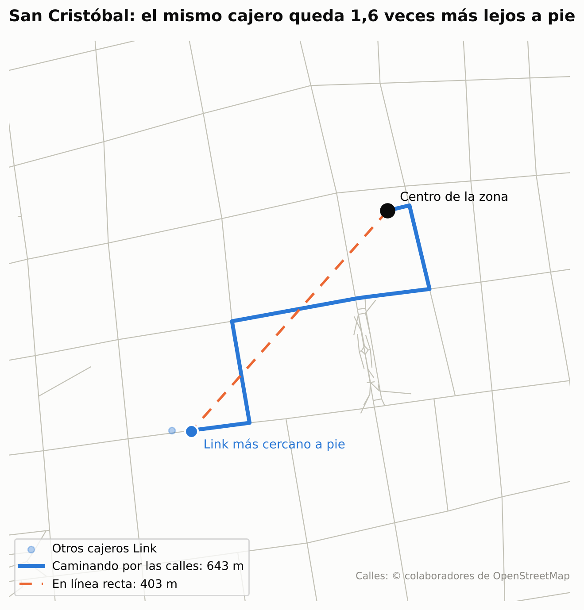

# Informe técnico · ¿Dónde faltan cajeros Link en CABA?

TPO de Ciencia de Datos · UADE · 2º cuatrimestre 2026 · Docente: Santiago Martín

Metodología: CRISP-DM. Código, datos y resultados: [github.com/ValentinoDiaz0509/CienciaDeDatos](https://github.com/ValentinoDiaz0509/CienciaDeDatos).
Este informe se genera a partir de los resultados del pipeline (`python docs/_construir/informe.py`); todos los números salen de `data/processed/`.

---

## Resumen ejecutivo

- Hoy el **51 %** de los vecinos de CABA tiene un cajero Link a menos de 500 m (caminando por las calles), contra el
  **64 %** de Banelco. Unas **1.507.883 personas** no tienen un Link a distancia caminable.
  Medir caminando cambia la respuesta: en línea recta, el 68 % de los vecinos tenía un Link a menos de 500 m; caminando por las calles, el 51 %. Uno de cada 4 vecinos que la línea recta daba por cubiertos en realidad tiene que caminar más.
- Los cajeros **siguen al comercio, no a los vecinos**: en los corredores comerciales hay
  17,9 terminales cada 10.000 vecinos; en los barrios
  residenciales, 5,3.
- Un modelo de **machine learning**, un ensamble de regresión de Poisson y XGBoost elegido entre 7 con validación cruzada
  espacial anidada (D² = 0,57; error medio de 4,2 terminales por zona), estima cuántos
  cajeros le corresponden a cada zona según su demanda. A Link le faltan terminales sobre todo en **Palermo** (le corresponden
  83, tiene 47) y **Belgrano** (52 contra
  30). Un clasificador **Random Forest** (AUC = 0,84) encuentra
  **254 zonas sin ningún cajero** que, por su demanda, deberían tener uno: viven ahí
  480.545 personas.
- Hay **dos estrategias**. **Competir** donde la demanda justifica más terminales Link de las que hay (Palermo, Belgrano, Recoleta).
  **Cubrir** los barrios residenciales (Belgrano, Villa Urquiza, Almagro) y el sur (Villa Lugano, Barracas, Villa Soldati), donde no hay un Link a distancia caminable.
- Con **20 cajeros** en las ubicaciones óptimas, Link suma **265.929 vecinos** y pasa al
  **59,8 %**. La diferencia con Banelco baja de 13 a 5 puntos; con 35 cajeros, Link igualaría la cobertura actual de Banelco. Al promedio
  nacional de 3.242 extracciones por terminal por mes (BCRA, 2025), son unas **64.840 operaciones mensuales**.
- Un segundo modelo **pronostica** cuánta gente va a entrar al subte cada día: **Random Forest** sobre variables del calendario erra un **8,0 %** por día en meses que no vio, contra 22,2 % de repetir el año anterior. Espera **765 mil entradas por día hábil** en septiembre de 2026 y 522 mil en enero de 2027: la Gerencia Técnica puede planificar cuándo reforzar la carga de efectivo y cuándo hacer el mantenimiento.
- El modelo se entrega como una **app** que la gerencia puede usar con su listado actual de cajeros.

---

## 1. Comprensión del negocio

### 1.1 Dominio
En la Argentina operan dos grandes redes de cajeros automáticos: **Red Link** y **Banelco**. Los bancos compran e instalan
las terminales; la red las conecta y procesa las operaciones. Según el BCRA, en julio de 2025 se hicieron **57,2 millones de
extracciones** en **17.643 cajeros** del país (unas 3.242 por terminal por mes), con una caída interanual cercana al 40 %, en un
contexto de avance de los pagos digitales. Con menos uso del efectivo, **dónde** está cada terminal importa más: una terminal mal
ubicada es un costo fijo con poco uso.

### 1.2 Problema e hipótesis
> En CABA hay zonas con mucha demanda potencial y pocos cajeros Link; detectarlas con datos públicos le permite a la
> Gerencia Comercial y Técnica de Red Link proponerles a sus bancos dónde instalar las próximas terminales con un
> argumento medible, en vez de a ojo.

| Pregunta | Respuesta |
|---|---|
| ¿Qué resolvemos? | Dónde faltan terminales Link y dónde conviene sumarlas |
| ¿Para quién? | Gerencia Comercial y Técnica de Red Link (audiencia no especialista en datos) |
| ¿Cómo entrega valor? | Más vecinos con un Link cerca, más operaciones en la red y una priorización que reemplaza la decisión a ojo |

### 1.3 Supuestos y alcance
- Cada banco decide la instalación; Red Link puede proponer ubicaciones a los bancos de su red.
- Solo datos públicos: no se usan transacciones ni ningún dato interno de Red Link.
- Alcance: Ciudad Autónoma de Buenos Aires.
- Criterio de éxito: un modelo de demanda que generalice a zonas no vistas (validación espacial) y un conjunto de
  ubicaciones cuyo impacto se pueda medir en vecinos cubiertos.

## 2. Comprensión de los datos

| Fuente | Organismo | Período | Aporta |
|---|---|---|---|
| Cajeros automáticos (1.279 ubicaciones, 2.673 terminales) | GCBA · BA Data | ≈2017 | Oferta por red y banco |
| Censo 2022 por radio censal (3.820 radios) | INDEC | 2022 | Residentes, NBI, edad, educación, internet |
| Molinetes del subte (90 estaciones) | SBASE · BA Data | 2025 | Entradas por estación y hora |
| Molinetes del subte, serie diaria | SBASE · BA Data | enero de 2025 a agosto de 2026 | Entradas por día y estación, y por hora en toda la red (pronóstico) |
| Relevamiento de usos del suelo (417.764 parcelas) | GCBA · BA Data | 2022-2024 | Comercio, oficinas, vivienda |
| OpenStreetMap (≈29 mil puntos y red peatonal) | Colaboradores de OSM | 2026 | Comercios, estaciones, calles |
| Barrios | GCBA · BA Data | vigente | Límites |

**Calidad de datos (DAMA).** El listado de cajeros da bien en completitud (97 %), validez (100 %), unicidad (98,9 %: 14 duplicados por ubicación y banco) y consistencia (96,9 %), pero falla en **oportunidad**: el 31 %
de las ubicaciones está a nombre de bancos que dejaron de operar con ese nombre entre 2017 y 2024 (Citibank, BBVA Banco
Francés, Santander Río, HSBC). Lo tratamos como una foto de ≈2017. El censo por radio cubre el 99,2 % de la población oficial.
A los molinetes de 2025 les falta marzo y, del 1 al 12 de agosto, una parte de los registros trae la fecha invertida (ver 4.7). El CSV de usos del suelo no trae coordenadas, así que se tomaron del shapefile.
OpenStreetMap está incompleto para cajeros (206 contra 1.279).

**Hallazgos del EDA** (cinco tipos de análisis exploratorio, `notebooks/01_calidad_y_eda.ipynb`):
1. El 78 % de los hexágonos no tiene ninguna terminal y la distribución tiene cola larga, lo que justifica usar modelos de conteo.
2. Las terminales se asocian más con el comercio (ρ = 0,68) que con los residentes (ρ = 0,47).
3. El centro concentra el 40 % de las terminales con el 12 % de los vecinos.
4. Link tiene mayor participación en el sur, donde pesan los bancos públicos, y menor en el norte comercial.

## 3. Preparación de los datos

- **Unidad de análisis:** 2.793 hexágonos H3 de resolución 9 (≈0,07 km², unas 3 × 3 manzanas).
  Todos tienen el mismo tamaño y los mismos vecinos, lo que reduce el problema de la unidad de área modificable frente a
  unidades administrativas desiguales.
- **Residentes por hexágono:** interpolación areal desde los radios censales (se conservan los totales). Los porcentajes se
  calculan agregando numeradores y denominadores, nunca promediando porcentajes.
- **Área de influencia:** variables y objetivo se suman sobre el hexágono y sus 6 vecinos (≈400 m), la escala de una caminata.
- **Variables de demanda (14):** residentes, comercio (OSM y parcelas), oficinas, parcelas residenciales, pasajeros de
  subte, estaciones de tren, distancia al centro y al subte, % NBI, % sin internet, % de 65+, % universitarios, tasa de empleo.
  Se excluyen deliberadamente sucursales y cajeros: son oferta, no demanda.
- **Distancias:** Las distancias se miden **caminando** por la red peatonal de OpenStreetMap (4.817 km de calles y sendas, 52.090 esquinas), con el algoritmo de Dijkstra. En la mediana, caminar hasta el Link más cercano es 1,34 veces la distancia en línea recta. Cada punto se proyecta sobre la cuadra más cercana (no sobre la esquina, que sumaría hasta media cuadra en cada punta) y los cajeros candidatos se ubican sobre la vereda. Como análisis de sensibilidad, si cada punto se conecta también con las cuadras a menos de 25 m extra (una esquina, por ejemplo), la cobertura de Link pasa del 51,2 % al 52,6 %: el resultado no depende de ese detalle.

## 4. Modelado

Seguimos los cuatro niveles de análisis de la materia: el EDA es el **descriptivo**; los modelos de esta sección son el
**predictivo** (4.1 y 4.2 en el espacio, 4.7 en el tiempo) y el **diagnóstico** que lo explica (4.3); la segmentación y la optimización son el
**prescriptivo** (4.4 a 4.6).

### 4.1 Regresión: ¿cuántas terminales le corresponden a cada zona? (`notebooks/02_machine_learning.ipynb`)
Objetivo: terminales de todas las redes en el área de influencia. Es un conteo con muchos ceros y cola larga, así que
usamos pérdida de Poisson y medimos con la **devianza de Poisson (D²)**, el equivalente del R² para conteos, y el **error
absoluto medio (MAE)**.

**Validación cruzada espacial anidada.** Las zonas vecinas se parecen y comparten área de influencia: si se mezclan al azar
entrenamiento y prueba, el modelo "ve" la respuesta en los vecinos. Por eso se mide siempre en **comunas que el modelo no vio**
(GroupKFold por comuna, 5 particiones), y los hiperparámetros se eligen con GridSearchCV **adentro** de cada partición de
entrenamiento, también dejando comunas afuera (4 particiones internas). La regla de elección se fijó antes de ver los
resultados: el mayor D² promedio entre particiones.

| Modelo | D² espacial (promedio ± desvío) | D² aleatoria | MAE espacial |
|---|---|---|---|
| Ensamble (Poisson + XGBoost) | 0,57 ± 0,14 | 0,79 | 4,22 |
| XGBoost | 0,54 ± 0,18 | 0,78 | 4,29 |
| Random Forest | 0,54 ± 0,19 | 0,81 | 4,37 |
| Regresión de Poisson (GLM) | 0,53 ± 0,16 | 0,73 | 4,47 |
| Árbol de decisión (CART) | 0,42 ± 0,18 | 0,72 | 5,02 |
| Poisson solo con población | -0,10 ± 0,44 | 0,11 | 7,11 |
| Línea de base (promedio) | -0,21 ± 0,18 | -0,01 | 8,01 |

**Elección: Ensamble (Poisson + XGBoost)** (promedio geométrico de la regresión de Poisson y XGBoost): el D² más alto y más estable, y
el menor error. Con validación aleatoria habría ganado Random Forest (D² = 0,81),
que en comunas no vistas cae a 0,54: los árboles memorizan la geografía
(autocorrelación espacial). La regla "más vecinos, más cajeros" (Poisson solo con población) es peor que predecir el promedio.

**Sobreajuste y OOB (clases 6 y 8).** Un árbol de decisión mejora siempre en entrenamiento (D² = 0,97
con 15 niveles), pero en comunas no vistas el mejor resultado está en 8 niveles
(D² = 0,46) y después empeora. El error OOB del Random Forest da R² = 0,80,
pero en comunas no vistas el R² es 0,29: con datos espaciales el OOB es
optimista, por la misma razón que la validación aleatoria.

**Brecha** = terminales que le corresponden (predicción fuera de muestra) − terminales que tiene. Para Link, lo que le
corresponde es la predicción por la participación de Link en la ciudad (34,5 %). Por barrio, la predicción
de cada área de influencia se reparte entre sus 7 hexágonos para no contar cada terminal siete veces.

| Barrio | Residentes | Terminales Link | Le corresponden | Faltan | Participación Link |
|---|---|---|---|---|---|
| Palermo | 242.275 | 47 | 83 | **+36** | 26 % |
| Belgrano | 145.100 | 30 | 52 | **+22** | 24 % |
| Recoleta | 160.736 | 57 | 66 | **+9** | 28 % |
| Colegiales | 59.426 | 7 | 14 | **+7** | 18 % |
| San Cristóbal | 51.472 | 6 | 12 | **+6** | 29 % |

Hay barrios sin ninguna terminal Link a los que les corresponde alguna: Villa General Mitre (5), Agronomía (3), Versalles (2).
En el otro extremo, el microcentro (San Nicolás: tiene 180 terminales Link y le corresponden 36; Monserrat: tiene 51 terminales Link y le corresponden 22; Retiro: tiene 41 terminales Link y le corresponden 27)
concentra las casas centrales de los bancos públicos de la red y gente que llega en colectivo y tren, que el modelo ve solo
en parte: lo leemos como sobreoferta a revisar, no como cajeros que sobran.

### 4.2 Clasificación: ¿a esta zona le corresponde al menos un cajero?
Objetivo: el hexágono tiene o no al menos una terminal de cualquier red. Misma validación espacial anidada; el umbral marca
tantas zonas como las que hoy tienen cajero (tasa base), así que precisión y recall coinciden.

| Modelo | AUC espacial (promedio) | PR-AUC | Precisión = recall | AUC aleatoria |
|---|---|---|---|---|
| Random Forest | 0,830 | 0,606 | 0,572 | 0,852 |
| XGBoost | 0,830 | 0,604 | 0,570 | 0,848 |
| Regresión logística | 0,827 | 0,624 | 0,594 | 0,842 |
| Árbol de decisión | 0,795 | 0,547 | 0,542 | 0,817 |

Elegimos **Random Forest**: AUC de 0,83 en promedio por grupo de comunas
(0,84 con todas las zonas juntas). En la matriz de confusión, los falsos positivos son
**oportunidades**: 254 zonas sin ningún cajero que, por su demanda, deberían tener uno,
donde viven 480.545 personas (sobre todo en Palermo, Balvanera, Belgrano, Villa Crespo). Un árbol de 3 niveles, entrenado solo
para leer las reglas, empieza preguntando por la cantidad de comercios del hexágono.

### 4.3 Diagnóstico: por qué el modelo predice lo que predice
El modelo elegido es aditivo en escala logarítmica, así que la predicción de cada zona se descompone **exactamente** en el
aporte de cada variable (valores **SHAP**: TreeSHAP en XGBoost y coeficiente × valor en la regresión de Poisson). Según SHAP lo
que más pesa es comercios y servicios (OSM), parcelas comerciales, parcelas residenciales; según la importancia de **Gini** del Random Forest,
comercios y servicios (OSM), pasajeros de subte por día hábil, parcelas comerciales. En la regresión de Poisson, subir un desvío las parcelas comerciales multiplica
las terminales esperadas por 2,15; los comercios de OSM, por 2,05; el % de 65+, por
1,40; los pasajeros de subte, por 1,22; las parcelas residenciales, por 0,44;
y el % de hogares con NBI, por 0,87.

Tres zonas, tres decisiones:

| Zona | Demanda en ≈400 m | Le corresponden | Tiene | Decisión |
|---|---|---|---|---|
| Belgrano, a 600 m de la estación Juramento (D) | 17.264 vecinos, 555 comercios | 30,1 (10,4 Link) | 5 (ninguna Link) | **Competir** |
| Villa Urquiza, a 500 m de la estación Juan Manuel de Rosas (B) | 17.535 vecinos, 120 comercios, sin subte | 4,1 (1,4 Link) | 0 | **Un solo cajero Link** |
| Villa Soldati | 15.888 vecinos, 11 comercios | 0,5 | 0 | **Cubrir**, no competir |

En Villa Urquiza viven muchas personas pero el flujo de gente es bajo (pocos comercios y sin subte): le corresponde un solo
cajero Link (1,4 terminales), y hoy no tiene ninguno de ninguna red. En Villa Soldati el mercado no pondría un cajero; si el objetivo es acercar el
efectivo a quienes más lo usan, entra por la estrategia de cobertura.

### 4.4 K-Means: tipos de zona (`notebooks/03_optimizacion.ipynb`)
k = 4 por silueta (0,36) y codo, sobre variables de demanda estandarizadas (conteos en escala log).

| Tipo de zona | Residentes | Pasajeros de subte/día | Terminales cada 10 mil | Link cada 10 mil | NBI (mediana) |
|---|---|---|---|---|---|
| Residencial denso | 1.825.673 | 0 | 5,3 | 1,5 | 2,6 % |
| Corredores comerciales con subte | 857.976 | 686.058 | 17,9 | 6,7 | 4,3 % |
| Mayor vulnerabilidad social | 399.094 | 4.884 | 3,5 | 1,8 | 10,6 % |

### 4.5 Optimización: dónde sumar cajeros
**Problema de cobertura máxima** (MCLP; Church y ReVelle, 1974): elegir N sitios (hexágonos con comercio) que maximicen los
vecinos que pasan a tener un Link a menos de 500 m. Se resuelve con el **algoritmo goloso** (garantía de 1 − 1/e del óptimo por
submodularidad; Nemhauser, Wolsey y Fisher, 1978) y de forma **exacta** como programa lineal entero con HiGHS.

| Cajeros | Goloso (vecinos) | Exacto (vecinos) | Diferencia | Sitios en común | Segundos (exacto) |
|---|---|---|---|---|---|
| 5 | 80.292 | 80.292 | 0,00 % | 5 | 0,44 |
| 10 | 144.616 | 144.616 | -0,00 % | 10 | 0,42 |
| 20 | 264.384 | 265.929 | 0,58 % | 17 | 0,54 |
| 30 | 366.022 | 369.671 | 0,99 % | 27 | 0,44 |
| 50 | 538.631 | 544.973 | 1,16 % | 41 | 0,49 |

El goloso queda a menos del 1,2 % del óptimo. Las 20 ubicaciones óptimas:

| # | Barrio | Comuna | Tipo de zona | Vecinos que suma |
|---|---|---|---|---|
| 1 | Belgrano | 13 | Residencial denso | 18.418 |
| 2 | Balvanera | 3 | Residencial denso | 16.186 |
| 3 | Villa Lugano | 8 | Mayor vulnerabilidad social | 15.938 |
| 4 | Barracas | 4 | Mayor vulnerabilidad social | 14.889 |
| 5 | Barracas | 4 | Mayor vulnerabilidad social | 13.786 |
| 6 | San Cristóbal | 3 | Corredores comerciales con subte | 13.373 |
| 7 | Palermo | 14 | Residencial denso | 13.007 |
| 8 | Villa Lugano | 8 | Mayor vulnerabilidad social | 12.979 |
| 9 | Villa Lugano | 8 | Mayor vulnerabilidad social | 12.896 |
| 10 | Flores | 7 | Residencial denso | 12.726 |
| 11 | Almagro | 5 | Residencial denso | 12.715 |
| 12 | Villa Urquiza | 12 | Residencial denso | 12.686 |
| 13 | Belgrano | 13 | Residencial denso | 12.634 |
| 14 | Caballito | 6 | Residencial denso | 12.419 |
| 15 | Villa Urquiza | 12 | Residencial denso | 12.198 |
| 16 | Villa Soldati | 8 | Mayor vulnerabilidad social | 12.082 |
| 17 | Villa Urquiza | 12 | Residencial denso | 11.891 |
| 18 | Balvanera | 3 | Corredores comerciales con subte | 11.866 |
| 19 | Almagro | 5 | Residencial denso | 11.767 |
| 20 | Belgrano | 13 | Residencial denso | 11.472 |

### 4.6 Demanda por hora (`notebooks/04_demanda_por_hora.ipynb`)
Con los molinetes 2025 (690.863 entradas por día hábil), los picos son a las **8:00** y las
**17:00**. Un K-Means sobre la forma de la curva horaria de cada estación separa estaciones de **origen** (pico a la
mañana, barrios) y de **destino** (pico a la tarde, centro). 80 de 90
estaciones ya tienen un Link a menos de 500 m; sumar a los pasajeros de la hora pico de la mañana no cambia ninguno de los 20 sitios óptimos: el faltante grande está en los barrios, no en el transporte.

### 4.7 Pronóstico: cuánta gente va a pasar por el subte (`notebooks/05_pronostico_subte.ipynb`)
Las secciones anteriores predicen **dónde**; esta predice **cuándo**. Con la serie diaria de los molinetes (enero de 2025 a agosto de 2026;
578 días con datos) pronosticamos las entradas al subte de cada día de los seis meses siguientes al último dato,
para que la Gerencia Técnica planifique la carga de efectivo y el mantenimiento de los cajeros cerca de las estaciones.

- **Limpieza:** 28 días anómalos quedan afuera del entrenamiento y de la medición: paros y cortes (menos de la
  mitad de un día igual de las semanas de alrededor), registros duplicados (más de 1,25 veces) y 22 días con
  la **fecha mal cargada** en el archivo de 2025. Una parte de los registros del 1 al 12 de agosto trae la fecha como mes/día
  y, leída como día/mes, cae en el día 8 de otro mes: el 8 de cada mes de 2025 tiene un tercio más de pasajeros que un día
  típico y del 1 al 12 de agosto falta lo mismo, mientras que en 2026 no pasa. La prueba más clara: marzo de 2025 no está en el
  archivo, pero el 8 de marzo tiene entradas, que sumadas a las del 3 de agosto dan un domingo normal.
- **Variables (13, todas del calendario):** día de la semana, fin de semana, mes, día del mes, época del año (seno y coseno
  del día del año), semana del mes, feriado, feriado puente, día no laborable, día pegado a un feriado, vacaciones de invierno
  y año. Se conocen de antemano, incluso los feriados que se decretan con poco tiempo (como el del 9 de noviembre de 2026 por
  la visita del Papa), así que se puede pronosticar cualquier fecha futura.
- **Objetivo:** el logaritmo de las entradas del día, para que el error sea relativo.
- **Modelos (clases 6 y 8):** Random Forest (500 árboles) y XGBoost (800 árboles de profundidad 4), contra una referencia
  ingenua: el mismo día de la semana del año anterior.
- **Validación hacia adelante con origen móvil:** se entrena con el pasado y se mide en los cuatro meses siguientes, que el
  modelo no vio. Dos veces (enero a abril de 2026 y mayo a agosto de 2026), siempre con al menos un año de historia; los tres se
  miden en los mismos días. Nunca se usan fechas futuras para entrenar.

| Período de prueba | Modelo | MAPE | MAE (entradas por día) | Error del total |
|---|---|---|---|---|
| enero a abril de 2026 | Mismo día del año anterior | 26,7 % | 79.717 | -1,9 % |
| enero a abril de 2026 | Random Forest | 9,2 % | 36.649 | -5,3 % |
| enero a abril de 2026 | XGBoost | 8,1 % | 36.945 | -4,3 % |
| mayo a agosto de 2026 | Mismo día del año anterior | 17,7 % | 72.491 | +6,6 % |
| mayo a agosto de 2026 | Random Forest | 6,8 % | 33.276 | +4,4 % |
| mayo a agosto de 2026 | XGBoost | 8,3 % | 42.194 | +6,3 % |

**Elección: Random Forest**, el de menor error promedio: MAPE de 8,0 %, contra 8,2 % de XGBoost y 22,2 % de la
referencia (su error es el 36 % del de la referencia). El error del total del período va de
-5,3 % a +4,4 % según el período: con menos de dos años de historia (y sin marzo de 2025), el
modelo capta solo en parte los cambios de nivel de un año a otro, así que conviene leer cada mes como un rango. Lo que más pesa
es día de la semana, fin de semana y feriado. El intervalo del 80 % sale de dos modelos XGBoost de cuantiles (10 y 90).

| Mes | Día hábil promedio | Rango probable (80 %) | Mismo mes, un año antes | Variación |
|---|---|---|---|---|
| septiembre de 2026 | 764.862 | 733.743 a 787.142 | 793.557 | -3,6 % |
| octubre de 2026 | 753.633 | 718.109 a 771.230 | 771.039 | -2,3 % |
| noviembre de 2026 | 727.429 | 675.652 a 755.779 | 759.279 | -4,2 % |
| diciembre de 2026 | 677.128 | 608.722 a 722.894 | 702.493 | -3,6 % |
| enero de 2027 | 521.899 | 495.437 a 538.552 | 523.962 | -0,4 % |
| febrero de 2027 | 581.133 | 546.182 a 607.081 | 603.076 | -3,6 % |

**Lectura para el negocio.** El día hábil promedio baja de 765 mil en septiembre de 2026 a
522 mil en enero de 2027 (-32 %): el verano es el momento para el mantenimiento
y las instalaciones, y los días previos a los de más gente, para reforzar la carga de efectivo. Las 10
estaciones sin un Link a distancia caminable van a recibir unas 44.593 entradas por día hábil.
Entre las 7 y las 10 de un día hábil entra el 23 % de la gente del día. Los
molinetes cuentan entradas al subte, no extracciones: son un indicador del flujo de gente cerca de las estaciones, no de la
demanda de efectivo.

## 5. Evaluación

- **Generalización (regresión):** D² espacial = 0,57 ± 0,14 entre grupos de
  comunas; MAE = 4,2 terminales por área de influencia.
- **Generalización (clasificación):** AUC espacial = 0,84; PR-AUC = 0,61 (la tasa base
  es 22 %).
- **Validación temporal:** de los 206 cajeros que OpenStreetMap tiene mapeados en 2026, 9 no
  estaban en el listado 2017. Cayeron, en promedio, en zonas con más brecha que el 67 % de la
  ciudad (p = 0,042, Monte Carlo). El AUC de la brecha es 0,64 y el de la probabilidad
  del clasificador, 0,58, contra 0,51 de usar solo la
  población. Es una evidencia a favor, pero modesta, por la cantidad de casos.
- **Pronóstico (validación hacia adelante):** MAPE de 8,0 % por día con Random Forest, contra 22,2 % de repetir el año anterior; en el último período (mayo a agosto de 2026), 6,8 % y sobreestima el total en 4,4 %.
- **Robustez:** sumar a los pasajeros de la hora pico de la mañana no cambia ninguno de los 20 sitios óptimos. El goloso queda a menos del 1,2 % del óptimo exacto, y medir
  con otra regla de conexión a la red cambia la cobertura en poco más de un punto.

**Limitaciones.**
- La oferta es de ≈2017.
- No hay transacciones: la demanda se aproxima con residentes, comercio y pasajeros.
- Lo que le "corresponde" a una zona compara contra cómo está repartido hoy el mercado, así que no detecta zonas que el
  mercado entero desatiende (la optimización por cobertura cubre ese caso).
- OpenStreetMap varía en completitud entre barrios.
- Los feriados en día de semana cuentan como hábiles en el promedio horario.
- La serie diaria del subte tiene menos de dos años (sin marzo de 2025): con más años, el pronóstico aprendería mejor la
  estacionalidad. No anticipa paros, lluvias ni eventos.
- Las distancias se miden desde el centro de cada hexágono y la red peatonal no tiene en cuenta semáforos, pendientes ni
  la percepción de seguridad de cada cuadra.

## 6. Despliegue

App en Streamlit con mapas de deck.gl (`streamlit run app/app.py`). Funciona sin internet. Incluye:
- mapa 3D de la brecha;
- predicción por zona: para cada barrio, cuántas terminales tiene y cuántas le corresponden, el porqué de cada zona (SHAP)
  y las oportunidades del clasificador;
- simulador de N cajeros (exacto o goloso, distancia caminando o en línea recta, con o sin pasajeros por franja horaria);
- demanda por hora y pronóstico de entradas al subte para los próximos seis meses;
- tipos de zona;
- carga del listado propio de cajeros, que recalcula cobertura y ubicaciones.

Una terminal nueva que alcance el promedio nacional suma unas 3.242 extracciones por mes, por unos 243 millones de pesos de efectivo (monto
promedio de julio 2025). El ingreso por operación es un dato interno: la app lo recibe como parámetro.

**Próximos pasos:**
- sumar más años de molinetes al pronóstico (el notebook 00c los baja cuando el catálogo de BA Data responde) y variables
  de clima y eventos;
- reportar a BA Data el error de fechas del archivo de molinetes de 2025;
- correr el modelo con el listado actual y las transacciones por terminal;
- sumar restricciones de costo y de seguridad por sitio a la optimización;
- validar la hipótesis horaria (carga de efectivo antes de los picos) con transacciones por hora.

## Uso de herramientas de IA

Usamos asistentes de inteligencia artificial como apoyo para programar, revisar el código y redactar. El grupo definió el
problema, eligió las fuentes y los métodos, y revisó el código y los resultados.

## Referencias

- BCRA (2025). *Informe Mensual de Pagos Minoristas*, agosto de 2025 (datos de julio de 2025).
- Boeing, G. (2017). OSMnx: New methods for acquiring, constructing, analyzing, and visualizing complex street networks. *Computers, Environment and Urban Systems*, 65, 126-139.
- Breiman, L. (2001). Random Forests. *Machine Learning*, 45(1), 5-32.
- Breiman, L., Friedman, J., Olshen, R. y Stone, C. (1984). *Classification and Regression Trees*. Wadsworth.
- Chen, T. y Guestrin, C. (2016). XGBoost: A scalable tree boosting system. *Proceedings of KDD 2016*, 785-794.
- Chapman, P. et al. (2000). *CRISP-DM 1.0: Step-by-step data mining guide*.
- Church, R. y ReVelle, C. (1974). The maximal covering location problem. *Papers of the Regional Science Association*, 32, 101-118.
- Dijkstra, E. W. (1959). A note on two problems in connexion with graphs. *Numerische Mathematik*, 1, 269-271.
- Fayyad, U., Piatetsky-Shapiro, G. y Smyth, P. (1996). From data mining to knowledge discovery in databases. *AI Magazine*, 17(3).
- Friedman, J. (2001). Greedy function approximation: a gradient boosting machine. *Annals of Statistics*, 29(5).
- Huangfu, Q. y Hall, J. (2018). Parallelizing the dual revised simplex method. *Mathematical Programming Computation*, 10, 119-142.
- Hyndman, R. y Athanasopoulos, G. (2021). *Forecasting: Principles and Practice* (3.ª ed.). OTexts.
- INDEC (2024). *Censo Nacional de Población, Hogares y Viviendas 2022*, base por radio censal.
- Koenker, R. y Bassett, G. (1978). Regression quantiles. *Econometrica*, 46(1), 33-50.
- Lundberg, S. y Lee, S.-I. (2017). A unified approach to interpreting model predictions. *NeurIPS 2017*.
- Lundberg, S. et al. (2020). From local explanations to global understanding with explainable AI for trees. *Nature Machine Intelligence*, 2, 56-67.
- McCullagh, P. y Nelder, J. (1989). *Generalized Linear Models* (2.ª ed.). Chapman & Hall.
- Nemhauser, G., Wolsey, L. y Fisher, M. (1978). An analysis of approximations for maximizing submodular set functions. *Mathematical Programming*, 14, 265-294.
- Openshaw, S. (1984). *The Modifiable Areal Unit Problem*. Geo Books.
- Roberts, D. et al. (2017). Cross-validation strategies for data with temporal, spatial, hierarchical, or phylogenetic structure. *Ecography*, 40(8), 913-929.
- Uber Technologies (2018). *H3: Uber's Hexagonal Hierarchical Spatial Index*.
- Varma, S. y Simon, R. (2006). Bias in error estimation when using cross-validation for model selection. *BMC Bioinformatics*, 7, 91.
- Wang, R. y Strong, D. (1996). Beyond accuracy: what data quality means to data consumers. *Journal of Management Information Systems*, 12(4).
- Fuentes de datos: GCBA (BA Data), INDEC, SBASE, © colaboradores de OpenStreetMap.
